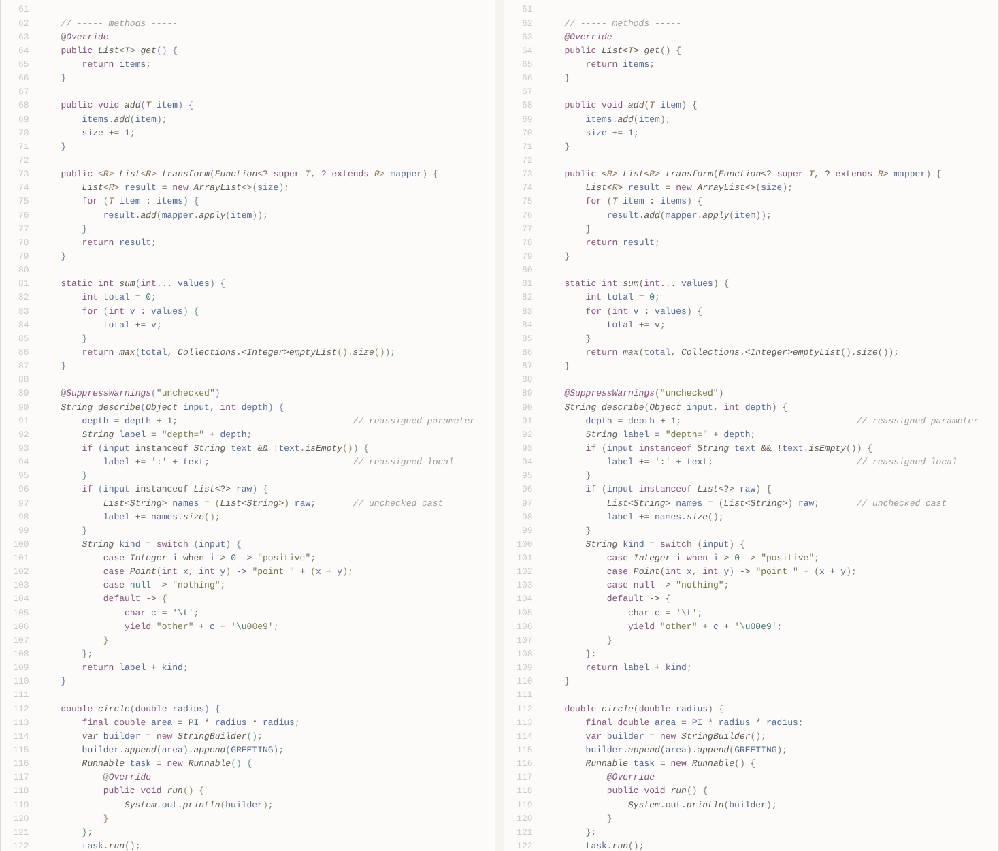

# Earl Grey for IntelliJ IDEA

Source of the [Earl Grey UI Theme](https://plugins.jetbrains.com/plugin/32608-earl-grey-ui-theme) plugin: a light
UI theme plus an editor color scheme. The scheme paints Java the way the
[Earl Grey](https://earl-grey.halt.wtf) VS Code theme does, checked token by token against what VS Code
(with Red Hat's *Language Support for Java*) actually renders.

*Left: VS Code. Right: IntelliJ with `Earl Grey.icls`. Same file, [samples/Showcase.java](samples/Showcase.java).*

## Install

Use **one** of these, not both: each adds its own entry to *Settings → Editor → Color Scheme*.

* **Plugin (recommended):** *Settings → Plugins → Marketplace*, search **Earl Grey UI Theme**. Pick **Earl Grey** in
  *Settings → Appearance & Behavior → Appearance → Theme*, and **EarlGrey** in *Settings → Editor → Color Scheme*.
* **Editor colors only:** *Settings → Editor → Color Scheme → ⚙ → Import Scheme…* and pick
  [`Earl Grey.icls`](Earl%20Grey.icls). It appears as **Earl Grey**.

The scheme is built on the light `Default` scheme, so pair it with a light IDE theme.

### Building and publishing the plugin

`tools/build-plugin.sh 1.2.0` writes `build/EarlGreyTheme-1.2.0.jar` (plugin id `wtf.halt.earlgrey.theme`):
* the UI theme and icons from [`plugin/`](plugin);
* `EarlGrey.xml`, generated from [`Earl Grey.icls`](Earl%20Grey.icls) under the published scheme name `EarlGrey`.

The jar layout is the same as earlier releases. It also carries the Parity license text, as the license requires.
Upload new versions from the plugin's page on JetBrains Marketplace, with a version number higher than the last one.

For the closest match to VS Code:

| Setting | Why |
|---|---|
| Install **Rainbow Brackets Lite** and set *Number of colors* to **6** | VS Code colors `( ) [ ] { }` by nesting depth (bracket pair colorization is on by default). The scheme already contains the six Earl Grey bracket colors for the plugin. |
| Same font, size and line height as VS Code | Colors match, but different metrics still make the editors look different. |
| *Editor → Color Scheme → Language Defaults → Semantic highlighting*: off | It is off by default. If it is on, every local variable gets its own rainbow color. |
| *Editor → Inlay Hints → Code vision*: off (optional) | VS Code shows no "N usages" lines above declarations. |

## Why earlier ports looked different

* **IntelliJ's stock colors leak through.** IntelliJ resolves a key in this order: the scheme's own value, the
  fallback chain inside the same scheme, and only then the parent scheme. Any Java key not set in the scheme
  comes from the bundled `Default` scheme: purple bold instance fields, purple italic static fields,
  underlined reassigned variables, olive annotations, teal type parameters. This scheme sets **every** Java key
  explicitly. `tools/compare.py` checks that none falls back to the parent.
* **The VS Code theme doesn't paint what its file says.** Earl Grey's `semanticTokenColors` entries for
  `parameter`, `variable`, `property`, `keyword`, `string`, `number` … are misspelled `"forground"`, so VS Code
  drops them. Those tokens fall back to the theme's TextMate rules instead. That is why fields, parameters and locals are
  `#556995` rather than the `#605A52` the file seems to ask for.
* **VS Code colors Java from two sources.** Red Hat's Java extension sends semantic tokens from jdt.ls, and they
  override the TextMate grammar per property. Methods (`#605A52` italic), type parameters (`#886A44`
  italic), packages (`#886A44`) and annotations come from semantic tokens. Since jdt.ls 1.60
  annotations are `decorator` tokens, which resolve to `#83577D` italic.

## Every kind of Java element

Each row counts occurrences in [samples/Showcase.java](samples/Showcase.java). An occurrence is "identical" when
every character has the same color, italic/bold and underline/strikethrough in both editors.

| Java element | Examples | Identical | VS Code | IntelliJ key |
|---|---|---|---|---|
| Class | `IOException`, `StringReader`, `ArrayList` | ✅ 82/82 | `#605A52 italic` | `CLASS_NAME_ATTRIBUTES` |
| Abstract class | `Animal` | ✅ 4/4 | `#605A52 italic` | `ABSTRACT_CLASS_NAME_ATTRIBUTES` |
| Interface | `List`, `Map`, `BiFunction` | ✅ 30/30 | `#605A52 italic` | `INTERFACE_NAME_ATTRIBUTES` |
| Enum | `ElementType`, `RetentionPolicy`, `Planet` | ✅ 7/7 | `#605A52 italic` | `ENUM_NAME_ATTRIBUTES` |
| Record | `Point`, `Num`, `Add` | ✅ 10/10 | `#605A52 italic` | `RECORD_NAME_ATTRIBUTES` |
| Annotation | `@Override`, `@Marker`, `Retention` | ⚠️ 3/13: name ✅, `@` ❌ ¹ | `#83577D italic` | `ANNOTATION_NAME_ATTRIBUTES` |
| Anonymous class (base type) | `Runnable` | ✅ 1/1 | `#605A52 italic` | `ANONYMOUS_CLASS_NAME_ATTRIBUTES` |
| Type parameter | `T`, `R` | ✅ 12/12 | `#886A44 italic` | `TYPE_PARAMETER_NAME_ATTRIBUTES` |
| Constructor declaration | `Showcase`, `Point`, `Planet` | ✅ 5/5 | `#605A52 italic` | `CONSTRUCTOR_DECLARATION_ATTRIBUTES` |
| Constructor call (`new`) | `ArrayList`, `StringBuilder` | ✅ 10/10 | `#605A52 italic` | `CONSTRUCTOR_CALL_ATTRIBUTES` |
| Method declaration | `get`, `add`, `transform` | ✅ 29/29 | `#605A52 italic` | `METHOD_DECLARATION_ATTRIBUTES` |
| Method call | `isEmpty`, `append`, `println` | ✅ 25/25 | `#605A52 italic` | `METHOD_CALL_ATTRIBUTES` |
| Static method call | `emptyList`, `of`, `sqrt` | ✅ 7/7 | `#605A52 italic` | `STATIC_METHOD_ATTRIBUTES` |
| Static method, statically imported | `max` | ✅ 1/1 | `#605A52 italic` | `STATIC_METHOD_IMPORTED_ATTRIBUTES` |
| Abstract / interface method call | `add`, `apply`, `size` | ✅ 15/15 | `#605A52 italic` | `ABSTRACT_METHOD_ATTRIBUTES` |
| Inherited method call | `name`, `speak` | ✅ 2/2 | `#605A52 italic` | `INHERITED_METHOD_ATTRIBUTES` |
| Annotation attribute | `value`, `priority` | ✅ 2/2 | `#605A52 italic` | `ANNOTATION_ATTRIBUTE_NAME_ATTRIBUTES` |
| Instance field | `size`, `running`, `timestamp` | ✅ 19/19 | `#556995` | `INSTANCE_FIELD_ATTRIBUTES` |
| Instance final field | `items`, `mass`, `length` | ✅ 9/9 | `#556995` | `INSTANCE_FINAL_FIELD_ATTRIBUTES` |
| Static field | `hits` | ✅ 4/4 | `#556995` | `STATIC_FIELD_ATTRIBUTES` |
| Static field, statically imported | `hits` | ✅ 1/1 | `#556995` | `STATIC_FIELD_IMPORTED_ATTRIBUTES` |
| Static final field (constant) | `GREETING`, `MAX_SIZE`, `VERSION` | ✅ 13/13 | `#556995` | `STATIC_FINAL_FIELD_ATTRIBUTES` |
| Constant, statically imported | `PI` | ✅ 1/1 | `#556995` | `STATIC_FINAL_FIELD_IMPORTED_ATTRIBUTES` |
| Enum constant | `RUNTIME`, `EARTH` | ❌ 0/6 ² | `#605A52 italic` | `STATIC_FINAL_FIELD_ATTRIBUTES` |
| Record component | `value`, `left`, `x` | ✅ 11/11 | `#556995` | `RECORD_COMPONENT_ATTRIBUTES` |
| Local variable (incl. `for`, resources) | `result`, `item`, `total` | ✅ 59/59 | `#556995` | `LOCAL_VARIABLE_ATTRIBUTES` |
| Reassigned local / parameter | `total`, `label`, `depth` | ✅ | `#556995` (no underline) | `REASSIGNED_*_ATTRIBUTES` |
| Parameter (method, catch, pattern) | `initialSize`, `mapper`, `e` | ✅ 58/58 | `#556995` | `PARAMETER_ATTRIBUTES` |
| Lambda parameter | `n`, `s`, `times` | ✅ 7/7 | `#556995` | `LAMBDA_PARAMETER_ATTRIBUTES` |
| Variable captured by lambda / anonymous class | `builder`, `area` | ✅ 2/2 | `#556995` | `IMPLICIT_ANONYMOUS_CLASS_PARAMETER_ATTRIBUTES` |
| Package name | `java.`, `util.` | ❌ 0/45 ³ | `#886A44` | `CLASS_NAME_ATTRIBUTES` |
| Keyword / modifier | `public`, `static`, `return` | ✅ 139/139 | `#83577D` | `JAVA_KEYWORD` |
| Primitive type | `int`, `void`, `boolean` | ✅ 43/43 | `#83577D` | `JAVA_KEYWORD` |
| `this` | `this` | ✅ 6/6 | `#83577D` | `JAVA_KEYWORD` |
| Contextual keyword | `record`, `sealed`, `permits`, `yield` | ✅ 8/8 | `#83577D` | `JAVA_KEYWORD` |
| `super`, `instanceof`, `true`/`false`/`null`, `var`, `when` | | ❌ ⁴ | various | `JAVA_KEYWORD` |
| String / char / text block | `"showcase"`, `'\t'` | ⚠️ 0/27: text ✅, quotes ❌ ⁵ | `#747B4D` | `JAVA_STRING` |
| String escape | `\n`, `\"`, `\t` | ⚠️ 4/5 (VS Code colors only the `\u` of `\u00e9`) | `#477A7B` | `JAVA_VALID_STRING_ESCAPE` |
| Number | `2`, `0x7F_FF`, `1_000L` | ✅ 39/39 | `#477A7B` | `JAVA_NUMBER` |
| Operator | `=`, `>>>`, `&&` | ⚠️ 105/117 ⁶ | `#605A52` | `JAVA_OPERATION_SIGN` |
| Comma, dot, semicolon | `,` `.` `;` | ✅ 201/201 | `#7F7A73` | `JAVA_COMMA`, `JAVA_DOT`, `JAVA_SEMICOLON` |
| Generic angle bracket | `<`, `>` | ❌ 0/43 ⁷ | `#7F7A73` | `JAVA_OPERATION_SIGN` |
| Brackets `( ) [ ] { }` | | with Rainbow Brackets ⁸ | depth colors | `*_BRACKETS_RAINBOW_COLOR0…5` |
| Line / block comment | `// static field` | ✅ 20/20 | `#9E9A95 italic` | `JAVA_LINE_COMMENT` |
| Javadoc tag | `@param`, `@link`, `@see` | ✅ 7/7 | `#83577D italic` | `JAVA_DOC_TAG` |
| Javadoc HTML | `
` | ✅ 1/1 | `#9E9A95 italic` | `JAVA_DOC_MARKUP` |
| Javadoc references | `Shape`, `area`, `initialSize` | ✅ 4/4 | as in code, italic | same keys as in code |
| TODO comment | `TODO: steep …` | ✅ 1/1 | comment + info squiggle `#556995` | `TODO_DEFAULT_ATTRIBUTES` |
| Deprecated API | `getId()` | ✅ | line-through | `DEPRECATED_ATTRIBUTES` |

The full per-character report, with both editors rendered side by side and the rule behind every token on
hover, is [docs/comparison.html](docs/comparison.html). Its machine-generated table is in
[docs/elements.md](docs/elements.md).

### Differences IntelliJ cannot express

These come from how IntelliJ assigns keys, so no color scheme can fix them:

1. Only the `@` differs. VS Code paints it as punctuation (`#7F7A73`), while IntelliJ includes it in the annotation name's range.
2. IntelliJ classifies enum constants as static final fields. VS Code paints them like types. The scheme
   keeps the much more common constants (`MAX_SIZE`, `PI` …) right.
3. IntelliJ highlights package segments with the class-name key (`HighlightNamesUtil.highlightPackage`). The
   scheme keeps class names right, and IntelliJ folds imports by default.
4. IntelliJ's lexer gives all of these the single `JAVA_KEYWORD` key. VS Code uses separate scopes: `true`/`false`/`null` and `super(…)` are
   teal `#477A7B`, `instanceof` and `when` are plain text, and `var` is painted as the inferred class.
5. In IntelliJ the quote characters belong to the string literal token. VS Code paints them `#7F7A73`.
6. VS Code paints the ternary `?` / `:`, the wildcard `?`, the label colon and the multi-catch `|` differently
   from other operators. IntelliJ has a single operator key. `->` and `::` have no key at all in IntelliJ.
7. IntelliJ lexes generic `<` `>` as operators. With Rainbow Brackets they take the angle-bracket color,
   which the scheme sets to `#7F7A73`, so they match too.
8. VS Code counts nesting on the text, while the plugin counts it on IntelliJ's syntax tree. Most brackets get
   the same color, but the body brace of `if (…) {` / `for (…) {` can land one level deeper in IntelliJ.

## How this was checked

`tools/run-comparison.sh` rebuilds [docs/comparison.html](docs/comparison.html) from scratch.

**VS Code side (exact):**
* [`vscode-textmate`](https://github.com/microsoft/vscode-textmate) with Oniguruma, VS Code's own engine,
  tokenizes the file with the Java grammar shipped by `redhat.java`.
* Eclipse JDT LS runs headless and produces the real semantic tokens.
* [`tools/vscode/vscode_render.py`](tools/vscode/vscode_render.py) resolves them with a line-by-line port of VS Code's
  `colorThemeData.getTokenStyle`. That port covers the type hierarchy, selector scoring, the default TextMate probes and
  `redhat.java`'s `semanticTokenScopes`.
* It also applies diagnostics (strikethrough for deprecated APIs, info squiggles) and bracket pair colorization.

**IntelliJ side (rule-based):**
* [`tools/intellij/IntelliJHighlightSimulator.java`](tools/intellij/IntelliJHighlightSimulator.java) (Java 21, javac
  Tree API) reproduces IntelliJ's Java highlighting:
  * the lexer layer from `JavaFileHighlighter`, including string escapes, Javadoc and its HTML;
  * the names layer from `JavaNamesHighlightVisitor` / `HighlightNamesUtil`;
  * reassigned variables, deprecation and TODO.
* Every rule cites the IntelliJ method it mirrors.
* [`tools/compare.py`](tools/compare.py) then resolves each key the way `EditorColorsSchemeImpl` does: scheme,
  then fallback chain, then the parent `Default` scheme. It layers the result like `LayeredTextAttributes` and
  `IterationState`, and diffs it against VS Code character by character.

The IntelliJ side models the IDE's rules rather than running the IDE, so give it a quick look in your own project
after importing.

## Credits and license

Earl Grey is by [June Kelly](https://halt.wtf), inspired by Flatwhite Syntax. The palette and this port are covered
by the [Parity License](LICENSE-PARITY.md), with third-party contributions under [Apache 2.0](LICENSE-APACHE.txt),
as in the original [earl-grey-vsc](https://github.com/earl-grey-theme/earl-grey-vsc).
