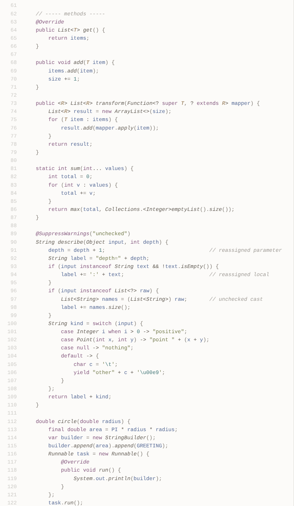

# Earl Grey for IntelliJ IDEA

A gentle, low-contrast light theme for IntelliJ IDEA and other JetBrains IDEs, following the design principles of
[Earl Grey](https://earl-grey.halt.wtf). Available on
[JetBrains Marketplace](https://plugins.jetbrains.com/plugin/32608-earl-grey-ui-theme) as **Earl Grey UI Theme**.



## Features

* **UI theme:** the warm Earl Grey palette across the IDE, including tool windows such as Project and Structure.
* **Editor color scheme:** Java highlighting matched token by token to the Earl Grey VS Code theme with Red Hat's
  Java extension. It covers classes, interfaces, records, enums, type parameters, methods, fields, constants,
  parameters, local variables, annotations and Javadoc.
* **Icons:** borderless, solid-color Java and file-type icons in the Earl Grey palette, with outlined folders.
* **Matching colors everywhere:** diff, search results, inlay hints, inspections and the console all use the Earl Grey
  palette.
* **Rainbow brackets:** Earl Grey bracket colors for the Rainbow Brackets (Lite) plugin.

## Installation

**From JetBrains Marketplace**

1. *Settings → Plugins → Marketplace*: search for **Earl Grey UI Theme** and install it.
2. *Settings → Appearance & Behavior → Appearance → Theme*: choose **Earl Grey**.
3. *Settings → Editor → Color Scheme*: choose **EarlGrey** if it isn't already selected.

**Editor colors only**

To use just the editor colors with another light IDE theme, open *Settings → Editor → Color Scheme → ⚙ → Import
Scheme…* and pick [`Earl Grey.icls`](Earl%20Grey.icls).

## Tips

* Install **Rainbow Brackets Lite** and set *Number of colors* to **6** to color nested brackets with the Earl Grey
  bracket palette.
* Keep *Settings → Editor → Color Scheme → Language Defaults → Semantic highlighting* off (the default), so variables
  use the Earl Grey colors.

## Building from source

Requires Python 3 and a JDK.

```sh
tools/build-plugin.sh                                    # writes build/EarlGreyTheme-<version>.jar
python3 tools/validate-plugin.py build/EarlGreyTheme-<version>.jar <version>
python3 tools/validate-plugin.py --icls "Earl Grey.icls"
```

The version comes from [`plugin/version.txt`](plugin/version.txt). To try a build, use *Settings → Plugins → ⚙ →
Install Plugin from Disk…*.

## Releasing

Set [`plugin/version.txt`](plugin/version.txt) to the new version and commit it to `main`. Editing the file on
github.com works. The Release workflow builds and validates the plugin, publishes a GitHub release, and uploads the
plugin to JetBrains Marketplace with the `JETBRAINS_MARKETPLACE_TOKEN` repository secret.

## Credits and license

Earl Grey is by [June Kelly](https://halt.wtf), inspired by Flatwhite Syntax. The palette and this port are covered
by the [Parity License](LICENSE-PARITY.md), with third-party contributions under [Apache 2.0](LICENSE-APACHE.txt),
as in the original [earl-grey-vsc](https://github.com/earl-grey-theme/earl-grey-vsc).
